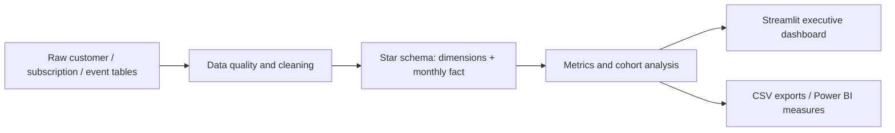

# SaaS Churn & Retention Executive Dashboard

**Live demo:** Not deployed yet. Run locally using the steps below.  
**Demo walkthrough:** See [the 30-second walkthrough outline](docs/demo_script.md).

## Executive summary

Built for a VP of Customer Success and SaaS Finance lead who need to decide where retention effort should go and how churn changes could affect recurring revenue.

- Tracks monthly recurring revenue (MRR), active customers, ARPA, churn, and signup-cohort retention.
- Builds a small warehouse star schema from deliberately messy, multi-table source data.
- Reports duplicates, missing values, malformed dates, noncanonical categories, and invalid negative prices.
- Includes a what-if control to estimate revenue retained under a lower monthly churn assumption. Results are illustrative, not realized savings.

## Architecture



## Business user and decisions

**Primary users:** VP of Customer Success and SaaS Finance lead.  
**Decision:** Which segments and churn reasons deserve retention attention, and what is the modeled recurring-revenue effect of reducing monthly churn?

The dashboard supports action planning. It does not claim that the synthetic data represents a real company's churn or savings. See [business decisions](docs/business_decisions.md).

## Key features

- Reproducible synthetic source tables with intentionally introduced quality issues.
- Cleaning and validation pipeline with a JSON quality report.
- Star schema: `dim_customer`, `dim_plan`, `dim_month`, and `fact_subscription_monthly`.
- Monthly MRR, active customer, churn, and ARPA metrics.
- Signup-cohort retention matrix.
- Churn reason and customer segment views.
- Adjustable churn-reduction scenario.
- SQL DDL and analytical queries, Power BI DAX measures, and an RLS implementation guide.
- Pytest suite and GitHub Actions workflow.

## Repository structure

```text
app/                 Streamlit dashboard
src/data/            Reproducible source-data generator
src/metrics/         Subscription, cohort, and scenario metrics
src/pipeline/        Cleaning, quality reporting, and star-schema build
data/                Generated raw, cleaned, and warehouse CSVs
sql/                 Warehouse DDL and analysis queries
powerbi/             DAX measures and RLS design
tests/               Unit and pipeline tests
docs/                Business framing, data quality, metric definitions
```

## Run locally

Python 3.10+:

```bash
python -m venv .venv
source .venv/bin/activate
pip install -r requirements.txt
python -m src.pipeline.build_warehouse
streamlit run app/main.py
```

## Run tests

```bash
pytest -q
```

## Data model and grain

`fact_subscription_monthly` is a month-end snapshot with one row per active customer per month. It joins to customer, plan, and month dimensions. See [warehouse schema](sql/warehouse_schema.sql).

## Evaluation and limitations

- Tests validate metric calculations, duplicate detection, and core warehouse output.
- Synthetic source data contains known defects so the cleaning pipeline can be inspected.
- The churn-reduction slider is a deterministic scenario model, not a causal estimate.
- The simple LTV proxy omits gross margin, discounting, expansion revenue, and acquisition cost.
- No predictive churn model is claimed; future churn outcomes must not be used as predictive features.
- RLS is documented as a deployment pattern; it is not an active security boundary in this local demo.

## Trade-offs

A transparent monthly snapshot and simple deterministic scenario were chosen so business users can audit the calculations. A production deployment should load source data incrementally, use a warehouse such as PostgreSQL/Snowflake, add role-specific access controls, and validate results against billing-system totals.

## Next steps for production

1. Replace synthetic CSV sources with an authenticated billing API or warehouse tables.
2. Add dbt tests and incremental models for the monthly fact.
3. Deploy Streamlit or publish a Power BI report with tested RLS roles.
