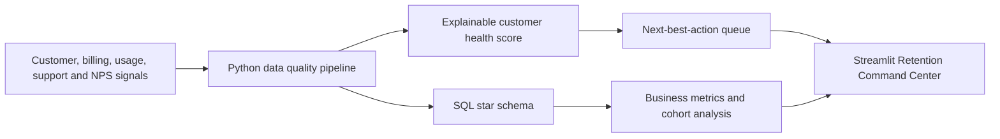

# SaaS Churn & Retention Executive Dashboard

**Live demo:** Not deployed yet. Run locally using the steps below.

## The business problem

A subscription business can see how many customers cancelled last month, but that does not tell its customer-success team who to contact today. This project turns subscription, product-usage, support, billing, and feedback signals into an explainable retention action queue.

**Primary users:** VP of Customer Success and SaaS Finance lead.  
**Decision supported:** Which active accounts should the team contact first, what action should they take, and what recurring revenue is exposed?

## The differentiator: Retention Command Center

The project goes beyond a standard churn dashboard with an explainable customer-health score and next-best-action queue.

- Scores each active account from 0 (lower risk) to 100 (higher risk) using product usage, usage decline, support burden, payment failures, and NPS.
- Explains the score using fixed weights rather than a black-box model.
- Recommends a next action such as payment recovery, service escalation, guided onboarding, or a customer-success check-in.
- Ranks high-risk accounts by risk-adjusted monthly revenue and exports a prioritized contact queue.
- Simulates the modeled revenue retained under user-selected outreach coverage and assumed save rate.

The score is a transparent heuristic, not a trained or validated prediction model. The intervention simulator is a what-if calculation, not a causal estimate or guarantee.

## Executive dashboard

The app includes five workspaces:
1. **Executive overview:** MRR, active customers, churn, ARPA, and revenue trends.
2. **Retention command center:** high-risk accounts, explainable risk drivers, next-best actions, and exportable action queue.
3. **Cohort retention:** retention by signup month and customer age.
4. **Churn drivers:** cancellation reasons and plan breakdown.
5. **Revenue simulator:** outreach coverage and assumed save-rate scenario.

## Architecture



## Data and realism

The reproducible generator creates synthetic customer and subscription records with engagement signals. The pipeline intentionally injects duplicate rows, missing values, malformed dates, inconsistent categories, and a negative price to demonstrate data-quality checks. No real customer data is included.

## Run locally

Python 3.10+:

```bash
python -m venv .venv
source .venv/bin/activate
pip install -r requirements.txt
python -m src.pipeline.build_warehouse
streamlit run app/main.py
```

## Run tests

```bash
pytest -q
```

## Engineering details

- Python ETL and validation.
- SQL star schema with customer, plan, and month dimensions plus monthly subscription fact.
- Power BI DAX measures and documented RLS pattern.
- Streamlit and Plotly interactive app.
- Docker and GitHub Actions test workflow.

## Limitations and trade-offs

The dataset is synthetic. The risk score is a transparent rules-based prioritization heuristic; it has not been trained or validated against real churn outcomes. The revenue-at-risk value is risk-weighted MRR, not a booked financial liability. The save-rate simulator is an assumption-based scenario, not a forecast or causal impact estimate. A production version should calibrate scores against historical outcomes, test intervention lift, and add authenticated data access.
