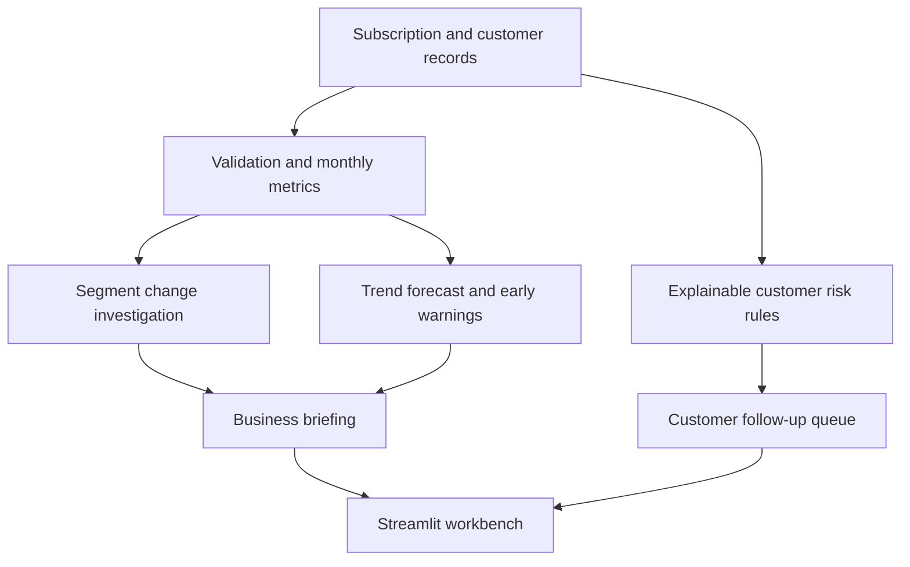

# Business Investigation Workbench

A Streamlit portfolio project that helps an analyst move from subscription data to a business explanation, a simple forecast, and a decision scenario.

**Live demo:** The Streamlit Community Cloud deployment should update from the main branch after the latest commits finish building.

## What problem does it address?

A business manager notices that recurring revenue has fallen. An analyst has to check the data, find where the change happened, estimate the business impact, consider what might happen next, and explain the findings.

This app brings several of those steps into one workspace. The analyst remains responsible for checking the evidence and deciding what action to take.

## Workspaces

1. **Business overview:** Monthly recurring revenue (MRR), active customers, churn and average revenue per account.
2. **Why did it change?:** Compare the latest month with the previous month and break MRR changes down by plan, acquisition channel or industry. The breakdown points to where to investigate; it does not prove cause.
3. **What happens next?:** Extend recent MRR or customer-count trends for 3–12 months, with a simple uncertainty range.
4. **Early warnings:** Flag unusually large month-to-month MRR movements using a transparent historical threshold.
5. **Customer actions:** Rank active accounts using explainable product usage, support, billing and NPS rules; export a follow-up list.
6. **Customer retention:** Compare retention across signup-month groups.
7. **What-if decisions:** Compare a baseline with a hypothetical churn reduction and price change.
8. **Business briefing:** Create a downloadable summary of the latest business position and its limitations.

## What makes the analysis inspectable?

- The risk score uses visible, fixed weights rather than an unexplained score.
- Segment comparisons show the underlying group-level revenue values.
- Forecasts use a simple linear trend over recent observations.
- Early-warning thresholds are calculated from the historical changes.
- Scenario assumptions are shown alongside the result.
- The app labels synthetic data, estimates and non-causal comparisons clearly.

## Data and assumptions

The included dataset is synthetic. It is useful for demonstrating the workflow but does not represent a real company's performance. The customer risk score is a hand-built prioritization rule, not a trained churn model. The forecast is a baseline trend estimate, not a validated forecasting model. The what-if simulator assumes customer mix and new signups stay constant and does not estimate how customers would react to a price change.

The current investigation compares monthly recurring revenue across available segments. It does not yet connect arbitrary company systems, establish causal drivers, calculate full profit impact, or learn whether a past intervention worked.

## Architecture



## Run locally

Python 3.10+:

```bash
python -m venv .venv
source .venv/bin/activate
pip install -r requirements.txt
python -m src.pipeline.build_warehouse
streamlit run app/main.py
```

## Run tests

```bash
pytest -q
```

## Next steps for a production-grade version

- Connect to databases and multiple source files, with explicit join suggestions and data lineage.
- Add more rigorous forecasting with backtesting and seasonality checks.
- Add root-cause investigation across product usage, support, billing and sales signals.
- Track business actions and compare expected outcomes with what actually happened.
- Add authentication, per-user data isolation and durable private storage before accepting confidential company data.

## Engineering details

Python, pandas, NumPy, Streamlit, Plotly, SQL warehouse schema, Power BI DAX examples, pytest and GitHub Actions.
